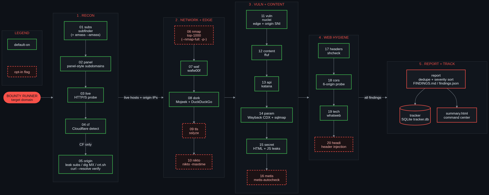

# Bounty Runner



A recon-to-report orchestrator for bug bounty hunters: one command chains your
tooling into a scan, dedupes the results and tracks the findings.

> **📖 Playbook:** for a step-by-step operational guide — install, launch
> presets, stage-by-stage reference, reading the results — see
> [PLAYBOOK.md](PLAYBOOK.md), also rendered as [a PDF](docs/PLAYBOOK.pdf).

## What it is

Bounty Runner runs a 20-stage pipeline (recon, scan, report, track) against a
target domain. It chains tools you already use (subfinder, nuclei, ffuf,
sqlmap, nmap and others), normalizes their output into one deduplicated,
severity-ordered report, and records findings in a local SQLite tracker. It
ships as a Python CLI plus an interactive terminal UI (Go, bubbletea) for
launching, monitoring and controlling runs.

## Legal: authorized use only

> **Only run Bounty Runner against targets you own or have explicit, written
> permission to test** (for example, an in-scope bug bounty program). Several
> stages are active and intrusive (port scans, nuclei templates, sqlmap, nikto,
> header injection) and can disrupt services or violate program rules and
> computer-misuse law. You are responsible for staying within scope and rate
> limits. The authors accept no liability for misuse.

## Requirements

- Python 3.10 or newer (the code uses `list[str] | None` style annotations)
- Go 1.27.3 or newer, only to build the TUI (version from `tui/go.mod`). With
  Go 1.21+ and the default `GOTOOLCHAIN=auto`, an older Go downloads the
  toolchain pinned in `go.mod` automatically
- `requests` (`requirements.txt`; everything else is stdlib), see [Install](#install)
- External tools, below

Missing tools are skipped with a warning (`runner/utils.py` `have()`), so you
can install only what you need.

| Tool | Stage(s) | Required? | Install |
|------|----------|-----------|---------|
| subfinder | `subs` | core | `go install github.com/projectdiscovery/subfinder/v2/cmd/subfinder@latest` |
| nuclei | `vuln` | core | `go install github.com/projectdiscovery/nuclei/v3/cmd/nuclei@latest` |
| katana | `api` | core | `go install github.com/projectdiscovery/katana/cmd/katana@latest` |
| ffuf | `content` | core | `go install github.com/ffuf/ffuf/v2@latest` |
| sqlmap | `param` | core | Kali/Debian: `sudo apt install sqlmap` |
| whatweb | `tech` | core | Kali/Debian: `sudo apt install whatweb` |
| dig | `origin` (MX lookup) | core (Cloudflare origin stage) | Kali/Debian: `sudo apt install dnsutils` |
| curl | `origin`, `origin_deep` (origin verification, crt.sh), `param` (Wayback CDX) | core | Kali/Debian: `sudo apt install curl` |
| wafw00f | `waf` | core | Kali: `sudo apt install wafw00f`; elsewhere `pipx install wafw00f` |
| shcheck | `headers` | core | vendored (`runner/vendor/shcheck.py`), nothing to install |
| nmap | `nmap` | opt-in (`--nmap`) | Kali/Debian: `sudo apt install nmap` |
| sslyze | `tls` | opt-in (`--tls`) | Kali: `sudo apt install sslyze`; elsewhere `pipx install sslyze` |
| nikto | `nikto` | opt-in (`--nikto`) | Kali/Debian: `sudo apt install nikto` (may not be in default Ubuntu repos) |
| headi | `headi` | opt-in (`--headi`) | `go install github.com/mlcsec/headi@latest` |
| amass | subdomain enum add-on | opt-in (`--amass`) | see the [amass](https://github.com/owasp-amass/amass) repo; needs API keys to be useful |
| metis-autocheck | `metis` | opt-in (`--metis`) | `metis-autocheck` shim that runs inside a local Metis install (not bundled); must be on `PATH`. Skipped if absent |

One-shot install of the common tools (apt packages are Kali/Debian names; on
Debian 12+ and Kali, `pip install` fails with `externally-managed-environment`,
so use apt or `pipx` for the Python tools):

```
sudo apt install nmap whatweb nikto sqlmap dnsutils curl
sudo apt install wafw00f sslyze      # Kali; elsewhere: pipx install wafw00f sslyze
go install github.com/projectdiscovery/subfinder/v2/cmd/subfinder@latest
go install github.com/projectdiscovery/nuclei/v3/cmd/nuclei@latest
go install github.com/projectdiscovery/katana/cmd/katana@latest
go install github.com/ffuf/ffuf/v2@latest
go install github.com/mlcsec/headi@latest
export PATH="$PATH:$(go env GOPATH)/bin"   # add to your shell rc; Go tools are skipped silently if not on PATH
```

The `content` stage uses `/usr/share/wordlists/dirb/common.txt` by default,
which exists on Kali. Elsewhere run `sudo apt install dirb` and pass
`--wordlist /usr/share/dirb/wordlists/common.txt`, or point `--wordlist` at a
SecLists file. If the wordlist is missing, `content` warns and skips.

The `dork` stage also needs outbound access to the Mojeek and DuckDuckGo HTML
search endpoints. If every engine blocks the queries, a warning is printed and
dork results are incomplete.

## Install

```
git clone https://github.com/busconductors/bounty-run.git bounty-run
cd bounty-run
make tui                      # builds bin/bounty-tui (optional but recommended)
```

Python dependency (`requests`). On Kali/Debian 12+ plain `pip install` is
refused (externally-managed-environment), so pick one:

```
sudo apt install python3-requests
```

or a virtualenv:

```
python3 -m venv .venv && .venv/bin/pip install -r requirements.txt
```

If you use the venv, the wrapper below must call `.venv/bin/python` instead of
`python3`, and the symlink option does not apply (the shebang uses the system
`python3`).

Put `bounty-run` on your `PATH`. Either create a small wrapper in
`~/.local/bin` (run from the repo root; it records the clone's path):

```
mkdir -p ~/.local/bin
cat > ~/.local/bin/bounty-run <<EOF
#!/bin/bash
exec python3 "$PWD/bounty_run.py" "\$@"
EOF
chmod +x ~/.local/bin/bounty-run
```

or symlink the entry point (it is committed executable and has a
`#!/usr/bin/env python3` shebang):

```
mkdir -p ~/.local/bin
ln -s "$PWD/bounty_run.py" ~/.local/bin/bounty-run
```

Make sure `~/.local/bin` is on your `PATH`.

The CLI writes to `<repo>/outputs`, but the TUI looks in
`~/tools/bounty-run/outputs` by default. If you cloned elsewhere, add this to
your shell rc so CLI runs show up in the TUI Runs screen:

```
export BOUNTY_OUTPUTS=/path/to/bounty-run/outputs
```

## Usage

### CLI

```
bounty-run example.com                 # default sweep, output to <repo>/outputs/<target>/<timestamp>/
bounty-run example.com -o results/     # custom output dir
bounty-run example.com --timeout 5     # faster HTTP probe (default 8s)
bounty-run example.com --skip param    # skip sqlmap (slow, active stage)
bounty-run example.com --skip dork,cors
bounty-run example.com --max-param-urls 10   # cap sqlmap targets (default 50)
bounty-run example.com --no-track      # do not ingest findings into the tracker DB

# Opt-in stages (off by default; most are intrusive or slow)
bounty-run example.com --amass         # also run amass passive enum
bounty-run example.com --nmap          # nmap top-1000 ports (intrusive)
bounty-run example.com --nmap --nmap-full   # all 65535 ports (can take hours)
bounty-run example.com --tls           # sslyze TLS/SSL deep scan (slow)
bounty-run example.com --nikto         # nikto web-server scan (intrusive, slow)
bounty-run example.com --metis         # Metis autocheck CVE sweep
bounty-run example.com --headi         # headi header-injection scan (intrusive)
```

Other flags: `--threads` (HTTP probe threads, default 30), `--max-hosts`
(default 1000), `--wordlist` (ffuf wordlist), `--nuclei-severity`,
`--nuclei-c` (concurrency), `--nuclei-timeout` (seconds, default 1800),
`--interactive` (prompt for output dir and engagement name), `--no-banner`,
`--events PATH` (see [Events and scripting](#events-and-scripting)). Run
`bounty-run --help` for the full list.

Large targets: only the first `--max-hosts` (default 1000) subdomains are
probed. Raise it for big scopes.

`--skip` takes a comma-separated list of these tokens:

| Token | Stage | Token | Stage |
|-------|-------|-------|-------|
| `subs` | subdomain enumeration | `api` | API endpoint discovery (katana) |
| `panel` | panel detection | `param` | param testing (Wayback + sqlmap) |
| `live` | live host probing | `secret` | secret / JS leak scan |
| `cf` | Cloudflare detection | `metis` | Metis CVE autocheck (opt-in) |
| `origin` | origin hunt (CF only) | `headers` | security headers |
| `origin_deep` | crt.sh deep origin (sub-step of `origin`) | `cors` | CORS misconfiguration |
| `nmap` | port scan (opt-in) | `tech` | technology fingerprint |
| `waf` | WAF fingerprint | `headi` | header injection (opt-in) |
| `dork` | search-engine dorking | `vuln` | nuclei vulnerability scan |
| `tls` | TLS/SSL analysis (opt-in) | `content` | content discovery (ffuf) |
| `nikto` | nikto scan (opt-in) | | |

### Findings tracker

Findings are ingested into a SQLite database at `outputs/tracker.db` unless you
pass `--no-track`. Manage them with `track`:

```
bounty-run track add-target example.com --program "Acme Bug Bounty"
bounty-run track add-finding example.com --title "SQLi" --severity high --url "https://x/?id=1"
bounty-run track list --status new
bounty-run track update 1 --status submitted --bounty 500
bounty-run track stats
```

`bounty-run dashboard` renders a static cross-run `dashboard.html` under
`outputs/`.

### Interactive TUI

`bounty-tui` is a terminal UI to launch, monitor and control runs. It drives the
Python engine through its `--events` mode. Start it with:

```
bounty-run                        # bare invocation on a terminal opens the TUI
bin/bounty-tui                    # or run the binary directly
bin/bounty-tui --outputs results/ # explicit outputs root (overrides $BOUNTY_OUTPUTS)
BOUNTY_RUN=/path/to/bounty-run bin/bounty-tui   # engine binary (default: bounty-run on PATH)
```

The outputs root defaults to `$BOUNTY_OUTPUTS` or `~/tools/bounty-run/outputs`.
A bare `bounty-run` without a terminal (pipes, cron) prints the normal usage
error instead. If the binary is missing, run `make tui`; `$BOUNTY_TUI` points
the launcher at a binary elsewhere.

Screens: **Runs** (all runs under the outputs root), **Launch** (new-run form),
**Monitor** (stage list, live output, findings table).

The Launch screen offers presets:

| Preset | Time | What runs |
|--------|------|-----------|
| Quick | ~5 min | Light and passive: subs, panels, live hosts, Cloudflare + origin hunt, WAF, dorks, secrets, headers, CORS, tech |
| Standard (default) | ~20-30 min | Quick + nmap top-1000, nuclei, ffuf, katana |
| Deep | hours | Standard + sqlmap, sslyze, nikto, Metis, headi, amass, nmap all ports (active/intrusive) |
| Custom | varies | Pick stages individually |

Runs are detached: quitting the TUI never stops a run, and you can re-attach
from the Runs screen. The TUI refuses to start a 4th run while 3 are active;
that cap is enforced only by the TUI, not by the engine. Cancel writes a
partial report and exits 130.

| Screen  | Key | Action |
|---------|-----|--------|
| Runs    | up/k, down/j | move selection |
| Runs    | enter | open run in Monitor |
| Runs    | n | new run (Launch) |
| Runs    | q, ctrl+c | quit |
| Launch  | enter | next field / submit |
| Launch  | shift+tab | previous field |
| Launch  | space, x | toggle a stage |
| Launch  | esc | back to Runs |
| Launch  | ctrl+c | quit |
| Monitor | tab | switch focus between output and findings |
| Monitor | f | cycle severity filter |
| Monitor | enter | finding detail (esc closes) |
| Monitor | o | open report in `$PAGER` (default `less`) after the run ends |
| Monitor | s | skip current stage (y to confirm, any other key declines) |
| Monitor | c | cancel run (y to confirm, any other key declines) |
| Monitor | K | hard kill; only while the "engine not responding" banner shows |
| Monitor | q, esc | detach (run keeps going) |
| Monitor | ctrl+c | quit |

## Pipeline

The 20 stages run in this order (these are also the `--skip` ids). Stages marked
opt-in only run when their flag is set.

1. `subs` - subdomain enum: `subfinder` (plus `amass` with `--amass`)
2. `panel` - flag cPanel/webmail/phpMyAdmin-style subdomains (no network)
3. `live` - HTTP/HTTPS probe (status, server, Cloudflare flag)
4. `cf` - Cloudflare detection from `cf-ray`/`server`/`cf-cache-status` headers and resolved IP
5. `origin` - when Cloudflare is detected: leak-subdomain sweep and MX records, filtered against Cloudflare's published ranges and verified with `curl --resolve`; plus `origin_deep` (crt.sh certificate-transparency history)
6. `nmap` - port scan (opt-in `--nmap`, `--nmap-full` for all ports)
7. `waf` - `wafw00f` fingerprint against live hosts
8. `dork` - passive Mojeek/DuckDuckGo queries for exposed files and panels, filtered to in-scope hosts
9. `tls` - `sslyze` protocols, weak ciphers, Heartbleed, ROBOT, certificates (opt-in `--tls`)
10. `nikto` - `nikto` per host, time-bounded (opt-in `--nikto`)
11. `vuln` - `nuclei` against live hosts
12. `content` - `ffuf` content discovery (auto-calibrated)
13. `api` - `katana` crawl for API endpoints
14. `param` - Wayback CDX parameter discovery and `sqlmap` injection testing
15. `secret` - secret and JavaScript leak scan
16. `metis` - Metis autocheck CVE sweep (opt-in `--metis`, via the `metis-autocheck` shim)
17. `headers` - security header checks (vendored `shcheck`)
18. `cors` - CORS misconfiguration checks
19. `tech` - technology fingerprint (`whatweb`)
20. `headi` - header-injection scan (opt-in `--headi`)

After the stages, a report step dedupes findings by (template, host) and writes
a severity-ordered `FINDINGS.md`, `findings.json`, `SUMMARY.md` and a
triage-first `summary.html`.

## Output files

```
outputs/<target>/<timestamp>/
├── subfinder.txt           # raw subfinder output
├── amass.txt               # amass output (--amass)
├── subdomains.txt          # deduped subdomain list
├── panels.txt              # panel-style subdomains (<sub>\t<kind>\t<severity>)
├── live_hosts.txt          # host, status, server, CF flag
├── cloudflare.json         # Cloudflare detection result + evidence
├── origin_candidates.txt   # origin IPs behind Cloudflare (if any)
├── origin_deep.txt         # crt.sh deep-origin candidates
├── nmap.xml                # raw nmap XML (--nmap)
├── nmap_open_ports.txt     # open ports per host (--nmap)
├── wafw00f_targets.txt     # hosts fed to wafw00f
├── wafw00f.json            # raw wafw00f fingerprint output
├── dork_urls.txt           # in-scope URLs found by dorking
├── dork.txt                # per-request dork log (<query>\t<engine>\t<ok|blocked>\t<hits>)
├── sslyze/<host>.json      # raw sslyze JSON per host (--tls)
├── tls_scan.txt            # TLS issues (<host>\t<template>\t<severity>) (--tls)
├── nikto/<host>.json       # raw nikto JSON per host (--nikto)
├── nuclei_targets.txt      # hosts/IPs fed to nuclei
├── nuclei.jsonl            # raw nuclei findings (JSONL)
├── content_discovery.txt   # ffuf-discovered paths
├── api_endpoints.txt       # endpoints found by katana
├── param_urls.txt          # parameterized URLs (Wayback CDX)
├── sqlmap_report.txt       # raw sqlmap output
├── metis_targets.txt       # hosts fed to Metis (--metis)
├── headi_raw.txt           # raw headi output (--headi)
├── whatweb.json            # raw whatweb output
├── security_headers.json   # raw shcheck output
├── cors_results.csv        # CORS check results
├── findings.json           # deduped, structured findings
├── FINDINGS.md             # human-readable, severity-ordered report
├── SUMMARY.md              # run summary
├── summary.html            # triage-first HTML summary
├── run.json                # engine pid/pgid/target/flags (--events or TUI launch)
├── events.jsonl            # JSON-lines event stream (--events or TUI launch)
├── control                 # pending skip/cancel commands (--events or TUI launch)
├── pids                    # child-tool process groups (--events or TUI launch)
└── engine.log              # TUI's capture of engine stdout/stderr (TUI launch only)
```

Files for skipped or opt-out stages are not created. `outputs/tracker.db` holds
the findings tracker and `outputs/dashboard.html` the cross-run dashboard.

## Events and scripting

With `--events`, the engine writes machine-readable progress that the TUI (or
your own tooling) can follow. Without `--events` the CLI output is unchanged.

- `run.json` - engine pid, pgid, start time, target, flags, version
- `events.jsonl` - schema v1 events (`run_start`, `stage_start`, `stage_end`,
  `progress`, `log`, `output`, `finding`, `run_end`), one JSON object per line
- `control` - the TUI appends `skip <stage>` / `cancel` lines; the engine
  consumes the file atomically (rename, then read)
- `pids` - process groups of running child tools (used for hard kill)
- `engine.log` - engine stdout/stderr when started by the TUI

For scripting, run the engine directly and follow the stream. The events file
must sit inside the `-o` dir: `run.json`, `control` and `pids` are written to
the events file's parent directory.

```
bounty-run example.com -o outputs/example.com/manual --events outputs/example.com/manual/events.jsonl
tail -f outputs/example.com/manual/events.jsonl | jq -c .   # jq optional
```

## Contributing and tests

```
python3 -m pytest              # Python engine tests
cd tui && go test ./...        # TUI tests
```

Issues and pull requests are welcome. Please read
[CONTRIBUTING.md](CONTRIBUTING.md) first, and keep changes covered by tests.

## Security

To report a vulnerability in Bounty Runner itself, see [SECURITY.md](SECURITY.md).

## License

MIT. See [LICENSE](LICENSE). Copyright busconductors.

## Reminder

Use this tool only on systems you are authorized to test. Respect program
scope, rate limits and applicable law.
